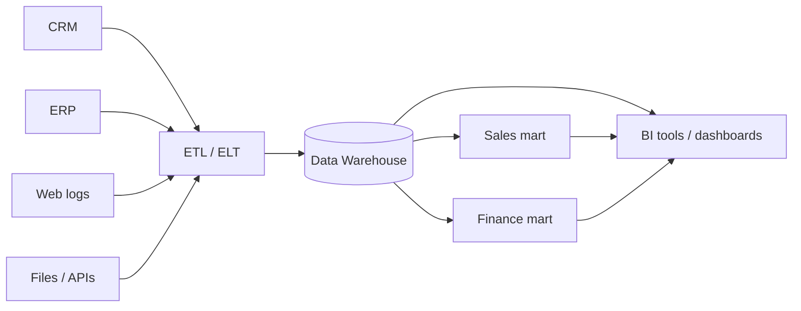
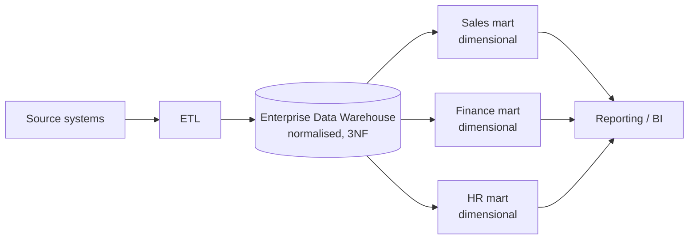
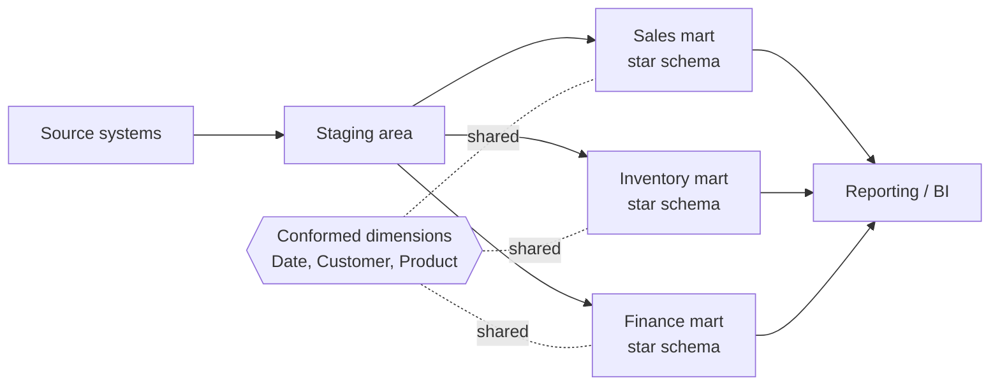
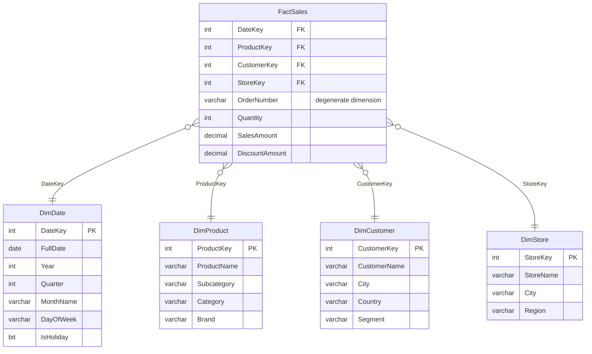
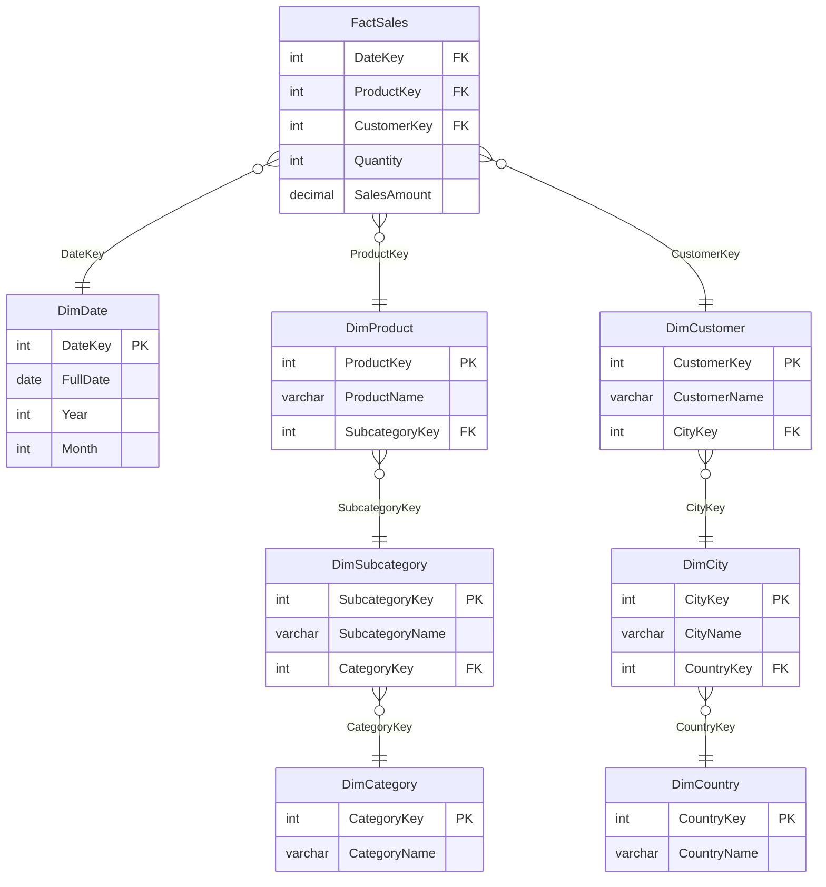
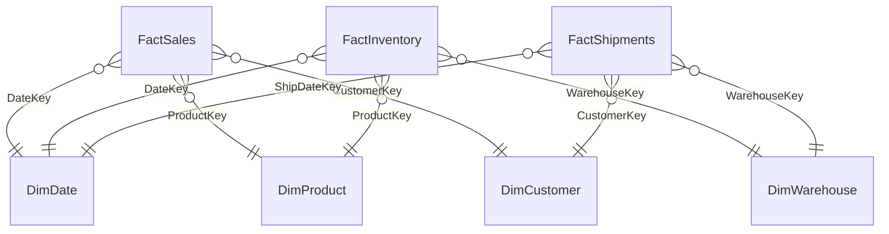

# Data Storage for Data Engineers: Data Warehousing

## Contents

1. Data storage landscape
2. OLTP vs OLAP
3. What is a data warehouse?
4. Inmon architecture (top-down)
5. Kimball architecture (bottom-up)
6. Inmon vs Kimball
7. Dimensional modelling
8. Fact tables
9. Dimension tables
10. Star schema
11. Snowflake schema
12. Galaxy schema (fact constellation)
13. Star vs Snowflake
14. Slowly Changing Dimensions (SCD)
15. Data Vault (brief)
16. ETL vs ELT and layered architecture
17. Example SQL
18. Quick revision summary

---

## 1. Data storage landscape

| Store | Purpose | Data | Schema | Examples |
|---|---|---|---|---|
| **Operational database (OLTP)** | Run day-to-day transactions | Current, detailed | Schema-on-write, normalised | SQL Server, PostgreSQL, MySQL |
| **Data warehouse** | Reporting and analytics | Historical, cleaned, integrated | Schema-on-write, structured | Snowflake, BigQuery, Redshift, Synapse |
| **Data mart** | Subset of a warehouse for one team or subject | Focused (e.g. Sales) | Usually dimensional | Sales mart, Finance mart |
| **Data lake** | Cheap storage of raw data of any type | Raw, structured and unstructured | Schema-on-read | S3, ADLS, GCS |
| **Data lakehouse** | Lake storage with warehouse features (ACID, SQL) | Raw and curated | Both | Databricks (Delta Lake), Iceberg, Hudi |

- **Schema-on-write:** structure is enforced when data is loaded.
- **Schema-on-read:** structure is applied when data is queried.

---

## 2. OLTP vs OLAP

| | **OLTP** (Online Transaction Processing) | **OLAP** (Online Analytical Processing) |
|---|---|---|
| Purpose | Run the business | Analyse the business |
| Operations | Many short reads and writes | Fewer, large, complex reads |
| Data | Current | Historical |
| Design | Highly normalised (3NF) | Denormalised (dimensional) |
| Users | Applications, front-line staff | Analysts, managers, BI tools |
| Optimised for | Fast inserts, updates, integrity | Fast aggregation and scanning |
| Example query | "Insert this order" | "Revenue by region by month over 5 years" |

---

## 3. What is a data warehouse?

A **data warehouse (DW)** is a central repository that integrates data from many source systems, stores it historically, and is optimised for analysis and reporting.

Bill Inmon's classic definition: a warehouse is **subject-oriented, integrated, time-variant and non-volatile**.

| Property | Meaning |
|---|---|
| **Subject-oriented** | Organised around business subjects (customers, sales), not applications |
| **Integrated** | Data from different sources is cleaned and made consistent |
| **Time-variant** | Holds history, so you can analyse trends over time |
| **Non-volatile** | Data is loaded and read, not routinely updated or deleted |



---

## 4. Inmon architecture (top-down)

Proposed by **Bill Inmon**, the "father of data warehousing". Build one **enterprise-wide, normalised warehouse first**, then derive data marts from it.



**ASCII version**

```
Sources --> ETL --> [ Enterprise Data Warehouse (3NF) ] --> Sales mart   --> BI
                                                        --> Finance mart --> BI
                                                        --> HR mart      --> BI
```

**Key features**
- The central warehouse is **normalised (3NF)**: a single source of truth with minimal redundancy.
- Data marts are **dependent**: they are built *from* the warehouse, so they stay consistent.
- Data is integrated and cleaned **once**, centrally.

| Advantages | Disadvantages |
|---|---|
| One consistent, enterprise-wide view | Long, expensive to build (big upfront design) |
| Low redundancy, easy to maintain integrity | Slower time to first value |
| Flexible to new questions and changing needs | Needs strong data modelling skills |
| Marts always agree with each other | More joins, so queries on the core are slower |

**Best for:** large organisations needing strong governance and one enterprise-wide truth.

---

## 5. Kimball architecture (bottom-up)

Proposed by **Ralph Kimball**. Build **business-process data marts first** using dimensional models, and the warehouse is the **combined collection of these marts**, glued together by **conformed dimensions**.



**ASCII version**

```
Sources --> Staging --> Sales mart (star)     \
                    --> Inventory mart (star)  >-- share conformed dimensions --> BI
                    --> Finance mart (star)   /
```

**Key features**
- The warehouse is **dimensional** (star schemas), not normalised.
- **Conformed dimensions** (e.g. one `DimDate`, one `DimCustomer`) are shared across marts, so results can be combined.
- Organised around **business processes** (sales, orders, shipments).
- Often described by the **Enterprise Bus Matrix**: business processes as rows, dimensions as columns.

| Advantages | Disadvantages |
|---|---|
| Fast to deliver, quick business value | Risk of inconsistency if dimensions are not truly conformed |
| Easy for business users to understand | Redundant data (denormalised) |
| Excellent query performance | Harder to adapt if source structure changes significantly |
| Works well with BI tools | Less suited to a single enterprise-wide integrated model |

**Best for:** teams that want quick, analyst-friendly reporting delivered in stages.

### Kimball's four-step design process

1. **Choose the business process** (e.g. retail sales).
2. **Declare the grain** (what one row of the fact table represents).
3. **Identify the dimensions** (who, what, where, when).
4. **Identify the facts** (the numeric measures).

---

## 6. Inmon vs Kimball

| | **Inmon** | **Kimball** |
|---|---|---|
| Approach | Top-down | Bottom-up |
| Build order | Enterprise warehouse, then marts | Marts first, combined via conformed dimensions |
| Central model | Normalised (3NF) | Dimensional (star schemas) |
| Marts | Dependent on the warehouse | The warehouse *is* the marts |
| Time to deliver | Slower | Faster |
| Upfront cost | High | Lower |
| Query performance | Slower on the core, fast on marts | Fast |
| Redundancy | Low | Higher |
| Complexity | Higher | Lower |
| Best for | Large enterprises, strong governance | Fast delivery, business-process reporting |

> In practice many organisations use a **hybrid**: an Inmon-style integrated layer feeding Kimball-style marts.

---

## 7. Dimensional modelling

**Dimensional modelling** is a design technique for warehouses that organises data into **facts** (numbers you measure) and **dimensions** (the context you slice them by). It is designed for fast, intuitive analysis rather than transaction processing.

| | Facts | Dimensions |
|---|---|---|
| Answer | "How much? How many?" | "Who? What? Where? When? Why?" |
| Content | Numeric measures | Descriptive attributes |
| Size | Very large (millions to billions of rows) | Relatively small |
| Growth | Grows quickly | Grows slowly |
| Example | `SalesAmount`, `Quantity` | Customer, Product, Date, Store |

A typical question: *"Total sales (fact) by product category (dimension) by month (dimension) for each region (dimension)."*

---

## 8. Fact tables

A **fact table** stores the measurable events of a business process. Each row is one event at a defined **grain**, containing **foreign keys to dimensions** and **numeric measures**.

### Structure

| Column type | Description | Example |
|---|---|---|
| **Foreign keys** | Link to each dimension | `DateKey`, `ProductKey`, `CustomerKey` |
| **Measures (facts)** | Numeric values to aggregate | `Quantity`, `SalesAmount` |
| **Degenerate dimension** | Identifier with no dimension table of its own | `OrderNumber`, `InvoiceNumber` |

The primary key is usually a **composite** of the foreign keys (or a surrogate key).

### Grain

The **grain** is what one row represents, for example "one product on one order line". **Always declare the grain first**, and never mix grains in one fact table.

### Types of measure

| Type | Meaning | Example |
|---|---|---|
| **Additive** | Can be summed across all dimensions | `SalesAmount`, `Quantity` |
| **Semi-additive** | Can be summed across some dimensions but not time | Account balance, stock level |
| **Non-additive** | Cannot be summed | Ratios, percentages, unit price |

### Types of fact table

| Type | What each row holds | Example |
|---|---|---|
| **Transaction** | One event at the lowest grain | One sales order line |
| **Periodic snapshot** | State at regular intervals | Account balance at month end |
| **Accumulating snapshot** | One row per process, updated as it moves through stages | Order: placed, shipped, delivered dates |
| **Factless** | Events with no numeric measures | Student attended class; promotion offered |

---

## 9. Dimension tables

A **dimension table** holds the descriptive context used to filter, group and label facts. Dimensions are **wide** (many attributes) and **denormalised** in a star schema.

### Features

- **Surrogate key:** a system-generated integer key (e.g. `CustomerKey`), independent of the source system's business key. It makes joins fast and supports history tracking.
- **Business (natural) key:** the original ID from the source (e.g. `CustomerID`).
- **Descriptive attributes:** text, categories, hierarchies.

### Common dimension types

| Type | Description | Example |
|---|---|---|
| **Date dimension** | One row per day with many calendar attributes | Year, Quarter, Month, Weekday, IsHoliday |
| **Conformed** | Shared consistently across multiple fact tables or marts | `DimDate`, `DimCustomer` |
| **Role-playing** | One dimension used several times in a fact | `DimDate` as OrderDate, ShipDate, DeliveryDate |
| **Junk** | Combines low-cardinality flags into one table | IsGift, PaymentType, Channel |
| **Degenerate** | An identifier stored in the fact table, no table of its own | OrderNumber |
| **Slowly changing** | Tracks attribute changes over time | Customer address history |
| **Mini-dimension** | Splits rapidly changing attributes from a large dimension | Customer demographics bands |

### Hierarchies

Dimensions often contain hierarchies: `Day > Month > Quarter > Year`, or `Product > Subcategory > Category`. These allow **drill-down** and **roll-up**.

---

## 10. Star schema

The simplest and most common dimensional design: **one central fact table surrounded by denormalised dimension tables**, forming a star shape.



**ASCII version**

```
                    +--------------+
                    |   DimDate    |
                    +--------------+
                           |
 +--------------+   +--------------+   +--------------+
 | DimProduct   |---|  FactSales   |---| DimCustomer  |
 +--------------+   +--------------+   +--------------+
                           |
                    +--------------+
                    |   DimStore   |
                    +--------------+
```

**Characteristics**
- Dimensions are **denormalised**: `Category` and `Subcategory` sit inside `DimProduct`.
- Every dimension joins directly to the fact table (one join per dimension).
- Simple queries, with few joins.

| Advantages | Disadvantages |
|---|---|
| Simple and intuitive | Redundant data in dimensions |
| Fewer joins, so faster queries | Larger dimension tables |
| Ideal for BI and aggregation | Updating a repeated value means changing many rows |
| Easy for business users to understand | Less flexible for complex hierarchies |

---

## 11. Snowflake schema

A variation of the star schema where **dimensions are normalised** into multiple related tables, so the diagram branches out like a snowflake.



**ASCII version**

```
 DimCategory -- DimSubcategory -- DimProduct --+
                                               |
 DimCountry -- DimCity -- DimCustomer ---------+-- FactSales -- DimDate
```

**Characteristics**
- Dimensions are split to remove redundancy (3NF-style): `Product > Subcategory > Category`.
- More tables and more joins per query.
- Saves storage and makes updates to shared values easier.

| Advantages | Disadvantages |
|---|---|
| Less data redundancy | More complex to understand |
| Smaller dimension tables, less storage | More joins, so slower queries |
| Easier to maintain hierarchies (change a category name in one place) | More complex ETL |
| Better data integrity | Poorer BI tool friendliness |

---

## 12. Galaxy schema (fact constellation)

**Multiple fact tables sharing conformed dimensions.** It is what a full Kimball warehouse looks like once several business processes are modelled.



```
FactSales ----+---- DimProduct ----+---- FactInventory
              +---- DimDate -------+
              +---- DimCustomer ---+---- FactShipments
```

This allows **drill-across** analysis, such as comparing sales with inventory, because both use the same `DimDate` and `DimProduct`.

---

## 13. Star vs Snowflake

| | **Star schema** | **Snowflake schema** |
|---|---|---|
| Dimension design | Denormalised | Normalised |
| Number of tables | Fewer | More |
| Joins per query | Fewer | More |
| Query speed | Faster | Slower |
| Storage | More (redundancy) | Less |
| Maintenance | Harder to update repeated values | Easier |
| Complexity | Simple | More complex |
| Data integrity | Lower (redundancy risk) | Higher |
| Typical use | BI, dashboards, most warehouses | Large, complex or shared hierarchies; storage-sensitive |

> Modern columnar warehouses compress data so well that storage savings matter less, so **star schemas are generally preferred**.

---

## 14. Slowly Changing Dimensions (SCD)

Dimension attributes change over time (a customer moves city). SCDs define how to handle that.

| Type | Strategy | History kept? |
|---|---|---|
| **Type 0** | Never change (fixed attribute) | n/a |
| **Type 1** | **Overwrite** the old value | No |
| **Type 2** | **Add a new row** with a new surrogate key and validity dates | Yes (full) |
| **Type 3** | Add a **column** for the previous value | Limited (one change) |
| **Type 4** | Move history to a separate **history table** | Yes |
| **Type 6** | Hybrid of 1, 2 and 3 | Yes |

### Type 2 example (most common)

A customer moves from London to Leeds on 1 June 2026.

| CustomerKey | CustomerID | Name | City | StartDate | EndDate | IsCurrent |
|---|---|---|---|---|---|---|
| 101 | C001 | Ada | London | 2024-01-01 | 2026-05-31 | 0 |
| 245 | C001 | Ada | Leeds | 2026-06-01 | 9999-12-31 | 1 |

Facts recorded before the move keep pointing to key `101`, so historical reports show London correctly. New facts point to `245`.

---

## 15. Data Vault (brief)

A third modelling approach designed for flexibility, auditability and loading from many changing sources.

| Component | Purpose |
|---|---|
| **Hub** | Unique business keys (Customer, Product) |
| **Link** | Relationships between hubs (Order links Customer and Product) |
| **Satellite** | Descriptive attributes and history, with load dates |

Data Vault is often used as the **integration layer**, with star schemas built on top for reporting.

---

## 16. ETL vs ELT and layered architecture

| | **ETL** | **ELT** |
|---|---|---|
| Order | Extract, Transform, Load | Extract, Load, Transform |
| Transform happens | In a separate engine before loading | Inside the warehouse after loading |
| Typical with | Traditional on-premise warehouses | Cloud warehouses and lakehouses |
| Raw data kept? | Often not | Yes |

### Layers in a modern warehouse


| Layer | Contents |
|---|---|
| **Staging / Bronze** | Raw copies of source data |
| **Integration / Silver** | Cleaned, conformed, joined data |
| **Presentation / Gold** | Dimensional models and marts ready for analytics |

---

## 17. Example SQL

### Create a star schema

```sql
CREATE TABLE DimDate (
    DateKey     INT PRIMARY KEY,          -- e.g. 20261008
    FullDate    DATE NOT NULL,
    [Year]      SMALLINT NOT NULL,
    [Quarter]   TINYINT NOT NULL,
    [Month]     TINYINT NOT NULL,
    MonthName   VARCHAR(10) NOT NULL,
    DayOfWeek   VARCHAR(10) NOT NULL
);

CREATE TABLE DimProduct (
    ProductKey   INT IDENTITY(1,1) PRIMARY KEY,   -- surrogate key
    ProductID    INT NOT NULL,                    -- business key
    ProductName  VARCHAR(100) NOT NULL,
    Subcategory  VARCHAR(50),
    Category     VARCHAR(50)
);

CREATE TABLE DimCustomer (
    CustomerKey  INT IDENTITY(1,1) PRIMARY KEY,
    CustomerID   VARCHAR(10) NOT NULL,
    CustomerName VARCHAR(100) NOT NULL,
    City         VARCHAR(50),
    Country      VARCHAR(50),
    StartDate    DATE NOT NULL,                   -- SCD Type 2 columns
    EndDate      DATE NULL,
    IsCurrent    BIT NOT NULL DEFAULT 1
);

CREATE TABLE FactSales (
    DateKey      INT NOT NULL REFERENCES DimDate(DateKey),
    ProductKey   INT NOT NULL REFERENCES DimProduct(ProductKey),
    CustomerKey  INT NOT NULL REFERENCES DimCustomer(CustomerKey),
    OrderNumber  VARCHAR(20) NOT NULL,            -- degenerate dimension
    Quantity     INT NOT NULL,
    SalesAmount  DECIMAL(12,2) NOT NULL,
    PRIMARY KEY (DateKey, ProductKey, CustomerKey, OrderNumber)
);
```

### Typical analytical query

```sql
SELECT d.[Year], d.MonthName, p.Category, SUM(f.SalesAmount) AS Revenue
FROM FactSales f
INNER JOIN DimDate d     ON f.DateKey = d.DateKey
INNER JOIN DimProduct p  ON f.ProductKey = p.ProductKey
GROUP BY d.[Year], d.MonthName, p.Category
ORDER BY d.[Year], Revenue DESC;
```

Note the pattern: **facts joined to dimensions, then `GROUP BY` dimension attributes and aggregate the measures.**

---

## 18. Quick revision summary

| Concept | One-line summary |
|---|---|
| **Data warehouse** | Integrated, historical, subject-oriented store optimised for analytics |
| **OLTP vs OLAP** | Run the business (normalised) vs analyse the business (denormalised) |
| **Inmon** | Top-down: normalised enterprise warehouse first, then dependent marts |
| **Kimball** | Bottom-up: dimensional marts first, united by conformed dimensions |
| **Dimensional model** | Facts (measures) surrounded by dimensions (context) |
| **Fact table** | Numeric events at a declared grain, with foreign keys to dimensions |
| **Dimension table** | Descriptive context, with a surrogate key |
| **Grain** | What one fact row represents; declare it first |
| **Star schema** | Fact table with denormalised dimensions: fewer joins, faster |
| **Snowflake schema** | Normalised dimensions: less redundancy, more joins |
| **Galaxy schema** | Several fact tables sharing conformed dimensions |
| **SCD Type 2** | Keep history by adding a new dimension row for each change |
| **Data Vault** | Hubs, links and satellites for flexible, auditable integration |
| **ETL vs ELT** | Transform before loading vs transform inside the warehouse |