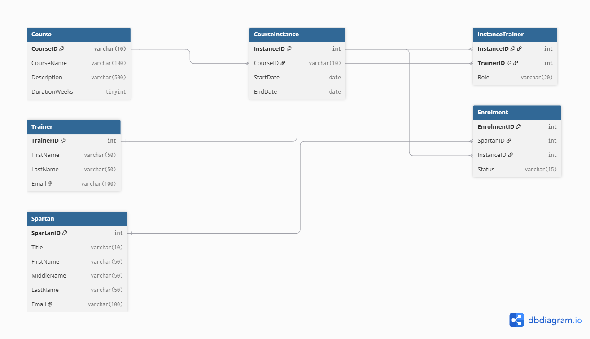

# SQL Practical Exercise: Spartans and Courses

## 1.1 Create the tables

```sql
DROP TABLE IF EXISTS Spartans_Table;
DROP TABLE IF EXISTS Course_Table;
GO

CREATE TABLE Course_Table (
CourseID VARCHAR(10) NOT NULL PRIMARY KEY,
CourseName VARCHAR(20) NOT NULL,
Trainer VARCHAR(20) NOT NULL,
StartDate DATE NOT NULL,
EndDate DATE NULL
);

CREATE TABLE Spartans_Table (
ID INT IDENTITY(1,1) PRIMARY KEY,
FirstName VARCHAR (20) NOT NULL,
MiddleName VARCHAR (20) NULL,
LastName VARCHAR (20) NOT NULL,
Email VARCHAR(100) NULL,
CourseID VARCHAR(10)  NOT NULL,
CONSTRAINT FK_Spartans_Course
        FOREIGN KEY (CourseID) REFERENCES Course_Table(CourseID)
);
```

## 1.2 Add data

```sql
INSERT INTO Course_Table (CourseID, CourseName, Trainer, StartDate)
VALUES 
      ('TECH 200', 'C# DEV', 'Jim Smith', '2026-10-06'),
      ('TECH 201', 'Java DEV', 'Jim Smith', '2026-09-06'),
      ('TECH 202', 'Data Engineer', 'Jim Smith', '2026-08-06'),
      ('TECH 203', 'Data Analyst', 'Jim Smith', '2026-07-06'),
      ('TECH 204', 'C# DEV', 'Jim Smith', '2026-06-06');

INSERT INTO Spartans_Table (FirstName, MiddleName, LastName, CourseID)
VALUES
    ('Bill', NULL, 'No', 'TECH 200'),
    ('Jim', 'Mary', 'Nigel', 'TECH 200'),
    ('David', NULL, 'Mitchell', 'TECH 201'),
    ('Steve', 'James', 'Penny', 'TECH 201'),
    ('Helen', NULL, 'Murphy', 'TECH 202'),
    ('Georgia', 'Alexander', 'Donkey', 'TECH 202'),
    ('Shrek', NULL, 'Shrek', 'TECH 203'),
    ('Peter', NULL, 'Angel', 'TECH 204');
```

## 1.3 Modify the tables

### 1. Add a Title column and populate it

```sql
ALTER TABLE Spartans_Table ADD Title VARCHAR(10) NULL;
GO

UPDATE Spartans_Table SET Title = 'Mr' Where FirstName IN ('Bill', 'Jim', 'David', 'Steve', 'Shrek', 'Peter');
UPDATE Spartans_Table SET Title = 'Mrs' Where FirstName IN ('Georgia', 'Helen');

SELECT ID, Title, FirstName, LastName FROM Spartans_Table;
```

### 2. CHECK constraint on Title

```sql
ALTER TABLE Spartans_Table
ADD CONSTRAINT CK_Spartans_Title CHECK (Title IN ('Mr', 'Mrs', 'Ms', 'Mx', 'Dr', 'Miss'));
GO

-- Test with an invalid title (should fail)
INSERT INTO Spartans_Table (Title, FirstName, LastName, CourseID)
VALUES ('Sir', 'Test', 'Person', 'TECH 200');
GO

SELECT ID, Title, FirstName, LastName FROM Spartans_Table;
GO
```


### 3. Unique Email

```sql
UPDATE Spartans_Table
SET Email = LOWER(FirstName) + '.' + LOWER(LastName) + '@spartaglobal.com';
GO

ALTER TABLE Spartans_Table
ADD CONSTRAINT UQ_Spartans_Email UNIQUE (Email);
GO

SELECT ID, FirstName, LastName, Email FROM Spartans_Table;
GO

-- Test duplicate email (should fail)
INSERT INTO Spartans_Table (Title, FirstName, LastName, Email, CourseID)
VALUES ('Mr', 'Copy', 'Cat', 'bill.no@spartaglobal.com', 'TECH 200');
GO
```

### 4. End date cannot be before start date

```sql
UPDATE Course_Table SET EndDate = DATEADD(WEEK, 12, StartDate);
GO

ALTER TABLE Course_Table
ADD CONSTRAINT CK_Course_EndAfterStart CHECK (EndDate IS NULL OR EndDate >= StartDate);
GO

SELECT CourseID, StartDate, EndDate FROM Course_Table;
GO

-- Test (should fail)
UPDATE Course_Table SET EndDate = '2020-01-01' WHERE CourseID = 'TECH 200';
GO
```

### 5. Lengthen CourseName without losing data

```sql
ALTER TABLE Course_Table ALTER COLUMN CourseName VARCHAR(100) NOT NULL;
GO

SELECT CourseID, CourseName FROM Course_Table;
GO
```

### 6. Status column with default 'Active'

```sql
ALTER TABLE Spartans_Table
ADD Status VARCHAR(15) NOT NULL
    CONSTRAINT DF_Spartans_Status DEFAULT 'Active';
GO

ALTER TABLE Spartans_Table
ADD CONSTRAINT CK_Spartans_Status CHECK (Status IN ('Active', 'Graduated', 'Withdrawn'));
GO

-- Insert without specifying Status
INSERT INTO Spartans_Table (Title, FirstName, LastName, Email, CourseID)
VALUES ('Dr', 'Ada', 'Love', 'ada.love@spartaglobal.com', 'TECH 200');
GO

SELECT ID, FirstName, LastName, Status FROM Spartans_Table;
GO
```

### 7. Make LastName mandatory

```sql
-- Check for rows that would break the rule
SELECT * FROM Spartans_Table WHERE LastName IS NULL;

-- Fix them first (none expected, as the column was created NOT NULL)
UPDATE Spartans_Table SET LastName = 'Unknown' WHERE LastName IS NULL;
GO

ALTER TABLE Spartans_Table ALTER COLUMN LastName VARCHAR(20) NOT NULL;
GO

SELECT * FROM Spartans_Table WHERE LastName IS NULL;   -- should return nothing
GO
```

### 8. Rename a column, then drop one

```sql
EXEC sp_rename 'Course_Table.Trainer', 'TrainerName', 'COLUMN';
GO

SELECT CourseID, CourseName, TrainerName FROM Course_Table;
GO

-- Add a throwaway column then remove it
ALTER TABLE Spartans_Table ADD Notes VARCHAR(50) NULL;
GO

ALTER TABLE Spartans_Table DROP COLUMN Notes;
GO

SELECT * FROM Spartans_Table;
SELECT * FROM Course_Table;
GO
```

## Extension: why ALTER TABLE is safer than drop and recreate

Dropping and recreating a production table destroys its data and everything attached to it, such as foreign keys, indexes, views, permissions and stored procedures. It also causes downtime, and a failure partway through can mean permanent data loss. `ALTER TABLE` changes only what needs changing. Existing rows stay in place and dependent objects keep working. Constraints are checked against existing data, so a bad change fails safely. The change can also be wrapped in a transaction and rolled back if something goes wrong.


## 1.4 Design an improved database

The original design allowed only one trainer per course, stored the trainer as plain text, and mixed a course (what is taught) with a course run (a cohort starting on a date). Each Spartan could also belong to only one course.

The improved design splits the data into six entities:

- **Course**: the catalogue of courses available.
- **CourseInstance**: one run of a course, with its own start and end dates.
- **Trainer**: a person who teaches.
- **Spartan**: a learner.
- **InstanceTrainer**: a junction table linking trainers to instances, so each instance can have multiple trainers and each trainer can teach many instances.
- **Enrolment**: a junction table linking Spartans to instances, so a Spartan can take several courses over time. `Status` lives here because it applies to a Spartan's place on a particular instance.

One Course has many CourseInstances. The two many-to-many relationships are resolved by the junction tables. The design is in 3NF, with no repeated trainer names and every fact stored once.

